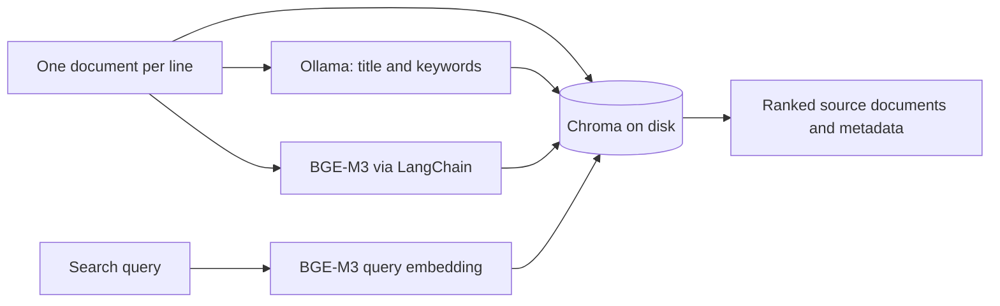

# Local Semantic Document Search

Search a document collection by meaning using **Chroma**, **BGE-M3 embeddings**, and **Ollama**. A local LLM creates a title and keywords for each document; Chroma stores the text, metadata, and vectors for later retrieval.

This project explores the retrieval side of a RAG pipeline: document ingestion, structured metadata extraction, vector storage, and nearest-neighbor search. It returns source documents rather than generating answers.

**Companion project:** [Elasticsearch Document Search](https://github.com/eddieliu-dev/elasticsearch-practice) runs full-text search over the same sample documents. The two repositories demonstrate different retrieval approaches and can be run independently.

## At a glance

- **Ingestion:** UTF-8 text → validated LLM metadata → BGE-M3 embeddings → persistent Chroma collection.
- **Retrieval:** natural-language query → query embedding → nearest documents by cosine distance.
- **Repeatable imports:** SHA-256 document IDs and upserts prevent duplicate records when a file is re-ingested.
- **Local services:** model inference runs through Ollama; vector storage lives on disk.
- **Small demo:** six synthetic documents covering energy, transport, food, computing, and flood protection.

## How it works



Ollama returns metadata constrained by a JSON schema. The application validates it before writing a record. Document and query embeddings are supplied explicitly, so Chroma does not silently select a different embedding model.

## Quick start

### 1. Install dependencies

Use Python **3.11 or 3.12** and install [Ollama](https://docs.ollama.com/quickstart).

```bash
git clone https://github.com/eddieliu-dev/chroma-vdb-project.git
cd chroma-vdb-project
python3.11 -m venv .venv
source .venv/bin/activate
python -m pip install -r requirements.txt
cp .env.example .env
```

### 2. Start Ollama and download the models

If Ollama is not already running, run this in a separate terminal:

```bash
ollama serve
```

Download the generation and embedding models. The first download requires several GB of disk space.

```bash
ollama pull llama3.1:latest
ollama pull bge-m3:latest
```

### 3. Ingest and search

```bash
python main.py ingest
python main.py count
python main.py query "How can buildings produce clean electricity?" --limit 3
```

With a fresh default collection, `count` returns:

```json
{
  "collection": "documents",
  "count": 6
}
```

Search returns a JSON array containing `id`, `distance`, `content`, `title`, `keywords`, `source`, and `ingested_at`. **Lower cosine distance means a closer match.** For the example query, inspect whether the rooftop-solar and battery documents appear among the results; exact titles, distances, and rankings depend on the model.

Example first result from a local run of that query (ID, source path, and timestamp omitted):

```json
{
  "title": "City Library Rooftop Solar Project",
  "keywords": [
    "solar",
    "energy",
    "library"
  ],
  "distance": 0.41160058975219727,
  "content": "A city library installed rooftop solar panels to generate electricity. The project reduces energy costs and supplies clean power to the building."
}
```

This is an observed demo result, not a retrieval benchmark. The rooftop-solar and battery documents ranked first and second in that run.

Progress messages go to stderr and JSON results go to stdout, so results can be saved directly:

```bash
python main.py query "storing energy after sunset" --limit 2 > results.json
```

## CLI and input format

```bash
python main.py --help
python main.py ingest --file data/sample.txt --collection demo
python main.py query "public transport for commuters" --collection demo --limit 2
python main.py count --collection demo
```

Each nonempty line is one complete document. Files are read as UTF-8, surrounding whitespace is stripped, and blank lines are skipped. `data/sample.txt` is the default synthetic dataset; the original Chinese news fixtures remain available through `--file`.

Ingestion preserves existing records and replaces records with identical content IDs. Re-ingesting regenerates metadata and updates the ingestion timestamp. Edited text gets a new ID; old versions are not automatically removed. An interrupted import can leave a partial collection, and rerunning the command safely resumes through upserts.

## Configuration

Settings are loaded from the repository's `.env` file; exported environment variables take precedence.

| Variable | Default | Purpose |
| --- | --- | --- |
| `OLLAMA_BASE_URL` | `http://localhost:11434` | Ollama server for generation and embeddings |
| `OLLAMA_MODEL` | `llama3.1:latest` | Title and keyword generation |
| `OLLAMA_TIMEOUT` | `300` | Timeout in seconds for each model request |
| `EMBEDDING_MODEL` | `bge-m3:latest` | Embedding model for documents and queries |
| `CHROMA_PATH` | `./chroma_data` | Persistent storage; relative paths resolve from the repository |
| `CHROMA_COLLECTION` | `documents` | Default collection name |

Use a **new collection** when changing the embedding model, then re-ingest the documents. Query and document vectors must come from the same model. Generated storage, `.env`, virtual environments, and IDE/cache files are ignored by Git.

## Design choices and tradeoffs

| Choice | Reason | Tradeoff |
| --- | --- | --- |
| Chroma persistent client | Keeps a small vector-search demo self-contained | Local storage rather than a distributed search service |
| BGE-M3 via Ollama and LangChain | Uses the same embedding pipeline for documents and queries | Querying requires the model server |
| Cosine distance with HNSW | Retrieves related text without requiring identical keywords | Relevance needs evaluation on a labeled query set |
| Structured LLM metadata | Makes titles and keywords inspectable and validates response shape | Valid JSON does not guarantee correct summaries |
| Content-based IDs | Makes repeated ingestion safe from duplicates | Identical text from different files shares a record |

Keywords are stored as JSON text in Chroma metadata for compatibility with scalar metadata values, then decoded to an array in CLI results. The source path and actual UTC ingestion time replace synthetic author names and dates.

## Tests

```bash
python -m unittest discover -s tests -v
```

Tests exercise a temporary, real Chroma database with small explicit vectors. They cover upserts, ranking, multiple results, missing/empty collections, document-level embedding input, and metadata validation. Ollama responses and embeddings are mocked, so no model download or running service is required. GitHub Actions runs the suite on Python 3.11 and 3.12.

## Project layout

```text
main.py                 CLI and ingestion workflow
config.py               Environment and .env configuration
chroma/                 Persistent client and collection operations
llm/                    Ollama metadata extraction and embedding setup
helpers/                Input reading, content IDs, metadata, and prompts
data/sample.txt         Six synthetic demo documents
tests/                  Model-free regression tests
.github/workflows/      Automated checks
```

## Limitations and next steps

This is a small retrieval prototype. It does not yet chunk long documents, batch imports, evaluate retrieval quality, combine lexical and vector rankings, or generate grounded answers. The next useful extension is a shared evaluation set for this project and its Elasticsearch companion, followed by hybrid retrieval and answer generation with source citations.

## Troubleshooting

- **Ollama request fails:** check `ollama list`, the configured URL/model, and whether `ollama serve` is running. Increase `OLLAMA_TIMEOUT` for slow hardware.
- **Collection does not exist:** run `ingest` with the same `--collection` before querying or counting.
- **Embedding dimension mismatch:** select a new collection and ingest again using the intended embedding model.

Implementation references: [Chroma collection API](https://docs.trychroma.com/reference/python/collection), [Ollama generation API](https://docs.ollama.com/api/generate), and [LangChain Ollama embeddings](https://docs.langchain.com/oss/python/integrations/embeddings/ollama).
